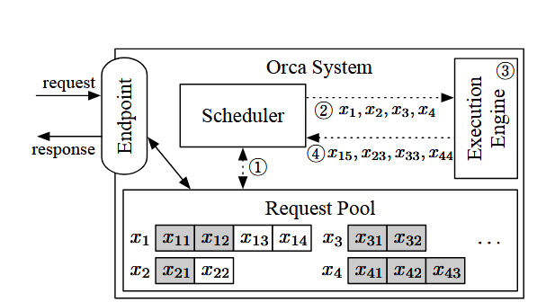

# ORCA: A Distributed Serving System for Transformer\-Based Generative Models

# 论文链接

https://www\.usenix\.org/system/files/osdi22\-yu\.pdf

# GPT的简要回顾

GPT是一种自回归（Autoregressive）的语言模型，基于Transformer的架构。模型接收一个输入token序列，然后通过生成后续输出token来完成该序列。

不同于传统的Transformer架构，GPT是仅仅包含解码器（Decoder）的架构，但保留了Transformer最核心的特征，即注意力机制（Attention mechanism）。注意力操作对感兴趣的词元计算加权平均，从而使序列中的每个词元都能感知到其他词元。它接收三个输入——**查询（Query）**、**键（Key）**和**值（Value）**，计算**Q**（针对当前词元）与**K**（针对感兴趣的词元）的点积，对点积应用**Softmax**以获得权重，并对与这些权重相关联的所有值进行加权平均。

值得注意的是，在模型推理过程中，每次计算都需要序列中所有token（包括用户新输入的和之前输出的）来计算所有的K和V。为了避免重复计算，Fairseq中提出了增量解码（Incremental Decoding）：推理时**一次只输入 1 个新 token**，把历史状态缓存复用，不用每一步把全部序列重新跑一遍。

---

# Request\-level Scheduling

传统的 Transformer 推理服务系统通常采用**批处理（batching）**来提高 GPU 利用率。多个请求会先由服务系统中的调度器从请求队列中取出，并组织成一个 batch，再交给执行引擎进行推理。执行时，不同请求对应的输入会被组织为批量张量，并共同执行 QKV Linear、Attention、MLP 等模型算子。这样不仅可以提高 GPU 的并行度，还能够让同一批请求复用从 GPU 显存中加载的模型参数。

在 Orca 之前的典型系统中，例如 Triton 负责请求调度，FasterTransformer 负责模型执行。调度器首先从请求队列中选取若干请求组成一个 batch，然后将整个 batch 交给执行引擎；执行引擎随后连续运行多轮 autoregressive decoding，直到这些请求完成生成。在图中的例子里，请求$x_1$的输入为 `“I think”`，请求$x_2
$的输入为 `“I love”`，二者被同时组成一个 batch，最终分别生成 `“this is great”` 和` “you”`。

---

# 创新点一：Iteration\-level scheduling（Continous batching）

## 问题：提前完成和延迟加入的请求

以请求$x_1$和 $x_2$为例，假设$x_2$很快生成 `"you"` 并结束，而 $x_1$仍需要继续生成 `"this is great"`。在传统请求级调度方式下，即使$x_2$已经完成，执行引擎仍然需要继续处理当前 batch，而调度器无法重新组织新的 batch。这样一来，已经完成的请求不能在完成后立即退出当前执行过程并及时返回结果，新的请求也无法立即填补已经空出的执行位置，只能等待当前 batch 整体处理结束。这样就大大消耗了 GPU 资源，拖慢了执行效率。

Decode x1 x2

Prefill x3 x4

## 方案

针对这一问题，Orca 将调度粒度细化到一次iteration。调度器在每一次生成 iteration 后重新控制。调度器首先从 Request Pool 中选择下一轮需要执行的一组请求，随后调用执行引擎为这些请求运行一次模型迭代；执行结束后，引擎将本轮产生的输出 token 返回给调度器，调度器据此更新每个请求的状态，并重新决定下一轮需要运行哪些请求。如果某个请求在当前 iteration 中已经生成结束标志，则可以立即将其从 Request Pool 中移除，并将结果返回给客户端。

如果有新的请求到达，也可以在下一次iteration中参与调度，无需等待之前整个 batch 中的请求全部完成。由此，Orca 能够动态控制每一轮需要处理的请求数量以及具体处理哪些请求，从而使有效 batch size 保持在较高水平。

上图展示了 Orca 采用Iteration\-level scheduling的整体架构。系统通过 Endpoint（\<EOS\>） 接收外部推理请求，并将新到达的请求加入 Request Pool。Request Pool 在请求的整个生命周期内维护其输入、状态以及已经产生的输出 token。Scheduler 持续监控 Request Pool，并在每一轮中选择需要运行的一组请求，将其交给 Execution Engine 执行一次模型迭代。Execution Engine 负责具体的 Tensor 计算，并可以进一步跨多个 GPU 或多台机器执行模型并行。

---

# 创新点二：Selective batching

## 问题：批处理任意一组请求

迭代级调度提高了请求调度的灵活性，但同时也带来了一个新的问题。由于调度器可以在每一轮任意选择请求，被同时选中的请求不再一定处于相同的执行阶段，也不一定具有相同的输入长度或历史序列长度。

即使对于一对请求 $(x_i, x_j)$，也无法保证在下一次迭代中它们的执行能够被合并并替换为批处理版本。对于一对请求而言，存在三种无法在下一次迭代中一起批处理的情况：

1. 两个请求都处于prefill阶段，且各自的输入 token 数量不同

2. 两者都处于decode阶段，且各自处理的 token 索引彼此不同；

3. 每个请求处于不同阶段。

传统批处理通常要求 batch 中的请求执行相同的操作，并且对应操作的输入张量具有兼容的形状。但在 Orca 的迭代级调度下，**不同请求在 Attention 阶段的张量 shape 不一致**。Prefill 请求长度不同，导致 `Q/K/V` 的序列长度不同；Decode 请求虽然当前 `Q` 都只有 1 个 token，但它们处在不同 token index，所以历史 `K/V`长度不同；Prefill 和 Decode 混在一起时，Prefill 的 `Q` 是多 token，而 Decode 的 `Q` 是单 token，形状天然不同。

举个例子：

### 以情况一为例：

$x_3=(x_{31},x_{32}), x_4=(x_{41},x_{42},x_{43})$

经过 QKV Linear 后：

$Q_3= \begin{bmatrix} q_{31}\\ q_{32} \end{bmatrix} \in\mathbb{R}^{2\times H} ,\qquad K_3= \begin{bmatrix} k_{31}\\ k_{32} \end{bmatrix} \in\mathbb{R}^{2\times H}$

$Q_4= \begin{bmatrix} q_{41}\\ q_{42}\\ q_{43} \end{bmatrix} \in\mathbb{R}^{3\times H} ,\qquad K_4= \begin{bmatrix} k_{41}\\ k_{42}\\ k_{43} \end{bmatrix} \in\mathbb{R}^{3\times H}$

传统 batch 想堆成：

$Q= \begin{bmatrix} Q_3\\ Q_4 \end{bmatrix},shape=[B,L,H]$

但问题是：

$Q_3:[2,H],\qquad Q_4:[3,H]$

长度对不上，**K、V 也是同样的问题**。因此处理 `Q3` 的话就要进行额外的 padding。在实际操作中会浪费很多空间。

## 方案

Orca 的关键是，请求之间存在不规则张量形状，并不意味着 Transformer 中的所有操作都无法进行批处理。

### 兼容处理

对于 Linear、LayerNorm、Add 和 GeLU 等非 Attention 操作而言，它们本质上都是针对每个 token 的 hidden representation 独立进行计算，并不需要知道某个 token 属于哪一个请求。因此，即使多个请求的 token 数量不同，也可以将所有 token 沿序列维展平，并组成一个二维张量。

例如， $x_3$包含 2 个 token， $x_4$包含 3 个 token，那么二者虽然无法直接组成规则的 `[B,L,H]` 张量，但可以拼接为一个 `[5,H]`的二维张量。该张量仍然可以直接输入 Linear、LayerNorm、GeLU 等操作，从而继续利用 GPU 的批量矩阵计算能力。

### 不兼容处理

但是，Attention 操作则不同。Attention 必须明确区分不同请求，因为一个请求中的 Query 只能与该请求自身的 Key 和 Value 进行计算，不能与其他请求的历史状态混合。因此，Orca 在进入 Attention 操作之前 **Split**，将此前合并的 token tensor 按照请求边界重新拆分，并分别为每个请求执行 Attention。Attention 完成后，再通过 Merge 将各请求的输出重新拼接成统一的二维张量，从而继续对后续的 Output Linear、MLP 等操作执行批处理。

为了支持增量解码，Orca 还维护了一个独立的 Attention K/V Manager。对于已经进入增量阶段的请求，本轮只需要计算一个新的 token，但 Attention 仍然需要访问该请求此前所有 token 对应的 Key 和 Value。因此，K/V Manager 会为每个请求分别维护历史 Attention 状态，并在下一轮执行时，将历史 Key、Value 与当前 token 新生成的 Query、Key 和 Value 一起提供给 Attention 操作。只有当请求完成后，调度器才通知 K/V Manager 释放对应的缓存状态。

---

# Orca的设计

## 分布式架构

由于 GPT\-3 等大规模生成模型的参数量可能达到数百亿甚至数千亿，单张 GPU 无法容纳完整模型，因此 Orca 组合了已有的 **Intra\-layer Parallelism** 和 **Inter\-layer Parallelism**。这两种方法原本主要应用于大模型分布式训练，Orca 将其用于生成模型的在线推理服务。

**Intra\-layer Parallelism** 将同一个 Transformer Layer 内部的矩阵运算及其参数切分到多张 GPU 上执行，可以近似理解为现在常说的 **Tensor Parallelism**。例如一个大的 Linear 层可以由多张 GPU 分别计算其中一部分结果，再通过 GPU 间通信完成结果聚合。**Inter\-layer Parallelism** 则沿模型深度切分 Transformer Layers，将不同层分配给不同的 GPU 组，可以理解为 **Pipeline Parallelism**。论文中的示例将一个 4 层模型划分为 2 个 inter\-layer partitions，每个 partition 内又采用 3 路 intra\-layer parallelism，因此总共使用 6 张 GPU。

在实际执行时，每个 Worker 负责一个 inter\-layer partition，并可以部署在不同机器上；Worker 内部则管理多张参与 intra\-layer parallelism 的 GPU。当 Scheduler 决定执行某个 batch 的一次 iteration 后，Engine Master 将当前 token、request ID、token index 等控制信息发送给第一个 Worker，随后模型中间张量按照模型层次依次流经后续 Worker。Orca 将**控制面与数据面分离**：中间 tensor 数据通过 NCCL 在 GPU 之间传输，而 request ID、sequence length 等 CPU 使用的控制信息则通过 gRPC 等独立通道传递，从而避免为了传输控制信息而频繁产生 CPU\-GPU 同步开销。

## 调度算法

在 Iteration\-Level Scheduling 和 Selective Batching 的基础上，Orca 的 Scheduler 需要进一步决定**每一次 iteration 到底选择哪些请求运行**。Orca 采用了 **FCFS（First\-Come\-First\-Served）** 策略，即优先处理更早到达的请求。

Scheduler 每轮首先从 Request Pool 中按照到达时间选择请求，直到达到预设的最大 batch size。

除了 batch size，调度器还必须考虑 **KV Cache 的显存容量**。Orca 为 Attention K/V Manager 预先划分一定数量的 K/V slots，其中一个 slot 表示存储一个 token 对应 Key 和 Value 所需的空间。当一个新请求第一次被调度时，Scheduler 根据该请求的 `max_tokens`，提前为它预留整个生命周期可能需要的 K/V 空间

当模型采用 Inter\-layer Parallelism 时，Orca 还会进一步让**多个 batch 在不同 Worker 之间形成流水线**。Scheduler 不会发送一个 batch 后立即等待结果，而是继续向 Execution Engine 注入后续 batch，直到正在运行的 batch 数量达到 Worker 数量。这样，不同 Worker 可以同时处理不同 batch 的不同模型分区，尽量避免 Pipeline 中的 Worker 空闲。

# 不足

1. **KV 显存利用率低**：新请求会按 `max_tokens` 预留 KV slots，比较保守，容易浪费显存（vLLM/PagedAttention） 

2. **Batch 计算量不均匀**：不同请求 prompt 长度、decode 历史长度不同，导致不同 iteration 的执行时间差很多，pipeline 容易出现 bubble（Sarathi\-Serve） 

3. **Prefill 和 Decode 仍然互相干扰**：虽然 ORCA 能把不同阶段请求一起调度，但没有真正隔离两种 workload，长 Prefill 可能拖慢 Decode（DistServe/Sarathi）

4. **调度粒度还不够底层**：ORCA 主要是 request/iteration\-level scheduling，没有管 GPU 内部 compute、memory、network 资源怎么分配（NanoFlow）

