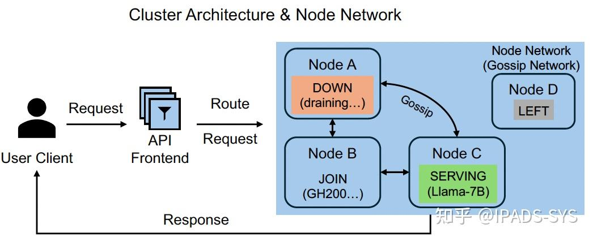
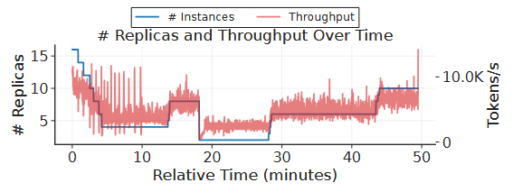

# 并行集群部署

## [Efficient LLM Serving on Commodity GPU Clusters with Data\-Reduced Cross\-Instance Orchestration \(OSDI\-26\)](https://link.zhihu.com/?target=https%3A//www.usenix.org/conference/osdi26/presentation/du)

> Jiangsu Du, Hongbin Zhang, Taosheng Wei, Zhenyi Zheng, Jiazhi Jiang, Kaiyi Wu, Zhiguang Chen, and Yutong Lu, *School of Computer Science and Engineering, Sun Yat\-Sen University*
> 
> 

### 背景

大模型在线推理通常需要通过多实例部署扩展服务能力。近年来的系统设计依据是否进行 prefill/decode（PD）分离，大致形成了两条路线：非分离（NoDG）系统在同一实例内完成 prefill 和 decode；

本文提出的完全分离（FuDG）系统则将两个阶段放在不同实例上执行，并在实例之间传输 KV cache。

FuDG 能避免两个阶段相互干扰，但通常依赖 NVLink、InfiniBand 等高性能互连。现实中仍有大量生产集群没有高带宽互联，仍采用 PCIe 和普通以太网。论文所使用的 NVIDIA L20 集群就来自实际互联网公司的服务环境，其节点间仅有 10 Gbps 以太网。因此，如何在缺乏高速互连的普通 GPU 集群上提高大模型服务效率，是一个具有明确现实价值的问题。

### 问题和挑战

现有两类方案在普通 GPU 集群上分别面临不同瓶颈：

- NoDG 的瓶颈是阶段干扰。 Prefill 和 decode 在同一实例内交替执行：优先 prefill 会阻塞已有请求的 decode，优先 decode 又会延迟新请求。频繁切换也使 decode 难以形成足够大的批次，降低 GPU 利用率。**Sarathi** 等系统通过 chunked prefill 缓解干扰，但会重复访问 KV cache，且效果受输入、输出长度比例影响。

- FuDG 的瓶颈是数据移动。 Prefill 实例生成 KV cache 后必须将其传给 decode 实例。论文测得，Llama\-30B 在 8 张 A800 上产生 KV cache 的速度约为 39 GB/s，对应至少 400 Gbps 的理论网络需求，普通集群难以满足。并且，FuDG 还引入资源配比和工程复杂度。 输入、输出长度随请求变化，prefill/decode 实例数量很难长期保持平衡；扩缩容需要同时调整两类实例，张量并行通信还可能与 KV cache 传输争用带宽。

论文的核心判断是：NoDG 与 FuDG 并非只能二选一。关键洞见在于，应联合设计实例内的执行时序与实例间的请求路由，在不搬运 KV cache 的前提下，用多个实例协作掩盖单实例阶段切换带来的等待。

因此，空间共享和时间共享面临一组看似矛盾的需求：系统既要在模型空闲时回收其显存，又要在多个模型同时活跃时让它们稳定共存。直接在两种策略之间切换也不够，因为需要换出的模型追求资源抢占，而需要共置的模型又要求资源持续可用，两者会在同一 GPU 上发生冲突。

进一步地，Prism 还需要解决两项系统挑战：一是如何在不暂停模型执行的情况下，跨模型、跨权重与 KV cache 快速伸缩物理显存；二是如何联合决定模型放置和请求执行顺序，使共享显存不会引发局部拥塞、饥饿或频繁迁移。

### 设计

EcoServe 提出部分分离策略 PaDG，并以 macro\-instance（宏实例）作为基本调度单元。一个宏实例包含多个普通推理实例，系统通过以下机制在实例内和实例间协同调度。

1. 时间维度上的 PD 分离

单个实例仍保存模型权重和本地 KV cache，但在较长的时间窗口内分别执行 prefill 或 decode，而不是频繁交替。这样既减少阶段间干扰，也避免 FuDG 的跨实例 KV cache 传输。其代价是：处于 decode 窗口的实例不能立即接收新请求，单实例使用时反而可能增加等待。

2. 滚动激活

为弥补单实例时间分离造成的空档，宏实例让多个实例以循环、错峰方式进入 prefill 窗口，保证任一时刻都有实例能够处理新请求。请求会被路由到当前适合执行 prefill 的实例，随后在同一实例内进入 decode。PaDG 的本质不是简单延长批处理窗口，而是用实例间的滚动激活换取实例内更稳定的执行阶段。

3. 自适应调度

宏实例调度器持续收集各实例的执行进度和显存占用，并在分派请求前检查三个条件：新增 prefill 是否超出 TTFT 约束、已有请求积累的 TPOT 余量能否覆盖这次 prefill、KV cache 是否会超出剩余显存。调度器优先沿循环顺序选择实例，使滚动激活保持稳定。

4. Mitosis 扩缩容

EcoServe 先在宏实例内部增减普通实例；实例数越过上下界后，再将宏实例拆分或合并。系统传递可序列化的实例代理，而不迁移模型和 KV cache，也不打断正在执行的请求。该设计将扩缩容粒度从整个宏实例细化到单个实例，并避免重新加载模型的高额开销。

### 测试评估

作者在三类集群上测试 EcoServe：64 张 L20、10 Gbps Ethernet；16 张 A800、25 Gbps RoCE；以及 16 张 H100、NVLink 与 400 Gbps InfiniBand。模型包括 Llama\-30B、CodeLlama2\-34B 和 Qwen2\-72B，负载来自 Alpaca\-gpt4、ShareGPT 和 LongBench；基线为 vLLM、Sarathi、DistServe 和 MoonCake。

最关键的实验结论如下：

- 普通互连集群上的收益最明显。 在 L20 和 A800 集群的所有测试组合中，EcoServe 均优于基线。按 P90 goodput 的平均结果，EcoServe 相比 vLLM、Sarathi、DistServe 和 MoonCake 分别提升 2\.01 倍、1\.87 倍、3\.43 倍和 3\.41 倍。这直接支持了 PaDG 适合普通互连集群的核心主张。

- 高速互连会缩小 EcoServe 的优势，但不会使其消失。 在 H100 集群上，相对上述四个系统的提升分别降至 1\.34 倍、1\.25 倍、1\.75 倍和 1\.24 倍。这说明 FuDG 的网络瓶颈得到缓解后，PaDG 的主要收益转向减少负载不均衡和调度开销；同时也界定了 EcoServe 的适用边界。

- 扩展性与设计有效性得到补充验证。 从 1 个实例扩展到 4 个实例时，CodeLlama2\-34B 和 Qwen2\-72B 的吞吐分别提高 4\.96 倍和 5\.47 倍。消融实验中，循环滚动激活优于随机选择实例，自适应路由也持续优于固定时间间隔路由，说明收益并非仅来自增加实例数量。

## [Revisiting Pipeline Parallelism for LLM Serving \(OSDI\-26\)](https://link.zhihu.com/?target=https%3A//www.usenix.org/conference/osdi26/presentation/hwang)

> Soonjae Hwang and Jeongseob Ahn, *Korea University*
> 
> 

### 背景与问题

LLM 的参数和 KV Cache 往往超过单张加速器的容量，因此单机多卡服务需要模型并行。张量并行（TP）把每层矩阵切到多张卡上，能够缩短单 token 计算路径并自然保持各卡同步，但每层都要进行 all\-reduce 等集合通信；NVLink 可以掩盖这部分成本，PCIe、部分 AMD GPU 和 NPU 平台却可能受通信带宽限制。流水线并行（PP）按模型深度切层，只在阶段间传递激活，通信量更小并能重叠不同 microbatch，但任一阶段变慢都会让相邻阶段空闲。
作者重新审视 PP，指出训练中的 microbatch 较稳定，而在线推理同时具有随机到达、不同 prompt 长度、未知输出长度以及 prefill/decode 混跑的特点，阶段间计算方差会被流水线依赖放大成 bubble。固定 chunked prefill 虽能限制单次 prefill，却在小 chunk 的低计算效率和大 chunk 的高阶段失衡之间存在动态权衡；静态绑定的 decode microbatch 也会让不均衡反复出现。
论文把 PP 中的失衡归纳为三类：

1. Prefill–Prefill（P–P）失衡：不同 microbatch 的 prompt 长度不同，长 prefill 占用阶段更久。论文测得，将长度 2048 与 128 的 prefill 相继送入流水线可产生约 627 ms 的空泡。

2. Prefill–Decode（P–D）失衡：一个阶段处理计算密集的 prefill，另一个阶段只处理 decode，二者单轮耗时相差悬殊；混合了不同数量 prefill/decode 请求时也会出现同类问题。

3. Decode–Decode（D–D）失衡：即使全是 decode，不同 microbatch 中存活请求数也会不同。线性层 kernel 的效率还呈台阶状：论文平台上 batch size 96 到 128 的耗时只差约 5%，128 到 160 却扩大约 31%，因此 “多一个请求” 可能让一个阶段跨过硬件 tile 边界并显著变慢。

### 设计与实现

作者在 PP 与 chunked\-prefill 基础上加入两个控制维度：动态决定“本轮做多少 prefill”，以及在 decode\-only 阶段决定“哪些请求本轮执行”。

1. Greedy Dynamic Chunked Prefill：调度器维护离散的 chunk 候选集合，每经过一个流水线深度的调度轮次，根据近期 TTFT/TPOT 相对 SLO 的剩余 slack 调整 chunk：TPOT 紧张或系统轻载时减小 chunk 以消除空泡；TTFT 紧张且 TPOT 尚有余量时增大 chunk，以提高 prefill 吞吐并清空等待队列。KV Cache 低于水位线时还会进入内存保护分支。

2. Predictive Dynamic Chunked Prefill：预测方案对每个候选 chunk 估计单轮延迟和吞吐。模型将延迟拆成两部分：线性层成本由离线 profile 得到，近似为 token 总数的函数；attention 动态成本使用已有上下文、当前 prefill 长度及 decode 上下文长度等特征，并用递归最小二乘（RLS）在线更新。调度器据此：

    1. 用预测的流水线延迟与 TPOT、SLO 得到 **chunk 上界**；

    2. 根据近期到达率、prompt 分布和已等待请求的剩余 TTFT 预算，计算不让队列继续增长所需的最低吞吐，从而得到**下界**；

    3. 在可行区间**选最小 chunk**，以在满足吞吐需求的前提下最小化空泡；过载时则选择仍满足 TPOT 约束的**最大 chunk**。

3. Delay Scheduling：在 decode\-only 轮次，调度器检查各阶段 microbatch 的请求数，并尽量将其对齐到硬件高效边界。若超出边界不多，就暂时挂起溢出的请求；若差距较大，则向所有 microbatch 的平均负载靠拢，并按需恢复先前挂起的请求。TPOT Slack（“Slack ”是指请求的实际执行时间与其严格的服务级别目标（SLO）截止时间之间的时间差） 紧张时优先挂起较老请求以保护新请求的 TPOT；Slack 充足时优先挂起新请求，让旧请求尽快结束、释放 KV Cache。

### 实验评估

实验使用 4 张经 PCIe 4\.0 连接的 NVIDIA A100 40GB、Qwen2\.5\-32B/14B BF16，以及 Azure Conversation、ShareGPT、CNN\-DailyMail 和将 CNN 输入/输出长度反转得到的 decode\-heavy 工作负载。

- 对 Qwen2\.5\-32B，调好静态 chunk 的 PP 已普遍优于 TP；完整方案在 AzureConv、ShareGPT、CNN\-Reversed 上分别达到约 8\.47、36\.16、10\.42 req/s，而 TP 分别为 3\.48、12\.45、5\.98 req/s：

- 在 15 分钟 AzureConv 真实轨迹中，动态方案与离线调优的静态 PP 在达成率上差距不大，但延迟分布明显左移；当 TPOT SLO 收紧到 150 ms 时，greedy/predictive 的达成率分别是 PPstatic 的 3\.06/4\.14 倍：

## [FlexPipe: Adapting Dynamic LLM Serving Through Inflight Pipeline Refactoring in Fragmented  Serverless Clusters \(EuroSys\-26\)](https://dl.acm.org/doi/10.1145/3767295.3769316)

> Yanying Lin Shenzhen Institutes of Advanced  Technology, CAS; UCAS  UC San Diego; Shijie Peng Shenzhen Institutes of Advanced  Technology, CAS  UCAS;  Chengzhi Lu Nanyang Technological University; Chengzhong Xu University of Macau;  Kejiang Ye\* Shenzhen Institutes of Advanced  Technology, CAS
> 
> 

### 背景与问题

Pipeline Parallelism（PP）通过沿模型深度将不同层划分到多张 GPU，只在相邻 stage 之间传输 activation。相比 TP，它对高速 GPU interconnect 的依赖较低，因此特别适合 GPU 分散、无法组成大规模 NVLink domain 的 serverless cluster。

现有 pipeline serving 系统通常在模型部署时确定 pipeline stage 数量和模型划分，之后保持静态。但真实 serverless 环境同时存在以下三个问题：

1. **资源碎片化**：文章分析 Alibaba 集群 trace 后发现，空闲 GPU 在不同节点和时间上高度分散，很难持续获得一组连续、高带宽互联的 GPU。论文统计的 GPU 订阅率平均达到 216%，而剩余可用 GPU 的分散分布导致物理拓扑与逻辑需求之间持续不匹配。云环境中的资源碎片极大地阻碍依赖高带宽互连的通信密集型并行策略。

2. **Pipeline 本身存在 trade\-off**：细粒度流水线在突发性工作负载中提供了更优的弹性和批量处理能力，但会带来通信开销的代价：少 stage 的计算时间降低，说明每个 stage 轻很多，更容易拆开、扩容和并发；但 stage 数量增加，跨 GPU 通信时延同时也会上升。

3. **最优 Pipeline 并不固定**：请求分布的变异会导致流水线阶段不平衡，导致不同工作负载采用不同的最优架构。在高度突发的环境中，更深层的流水线架构可以通过分布式缓冲有效吸收峰值负载，显著优于静态配置。

核心问题是：

**能否在模型仍然处理请求的情况下，直接修改正在运行的 pipeline topology，使 pipeline granularity 随 workload 和可用 GPU 变化？**

### 设计

FlexPipe 由三个部分组成：细粒度模型分区 \(Fine\-grained Model Partitioning\)、在途管道重构 \(Inflight Pipeline Refactoring\) 和 拓扑感知资源分配 \(Topology\-aware Resource Allocation\)。

1. **Fine\-Grained Pipeline Model Partitioning**

FlexPipe 采用操作符级别的模型分解，以创建计算和重构潜力都得到优化的平衡管道阶段。它通过分析计算图并建立自然的分区边界，构建了**从通信开销最小的粗粒度阶段，到能够在突发工作负载期间快速扩展的细粒度阶段**的管道架构。分区过程通过一个约束优化问题来实现，该问题同时考虑了通信\-计算重叠和未来的重构需求：

$\min_{\{S_k\}_{k=1}^K} t_c(S_k) + \frac{s_p(S_k)}{B} - C + \lambda \cdot R(S_k) \\
\text{s.t. } \bigcup_{k=1}^K S_k = V, \quad S_i \cap S_j = \emptyset \quad \forall i \neq j \\
\max_{S_k} s_p(S_k) \le M_{GPU}$

其中，$K$ 是阶段数，$S_k$ 表示包含操作符子集的第 $k$ 个阶段，$V$ 是计算图中的所有操作符，$t_c(S_k)$ 是阶段 $k$ 的计算时间，$s_p(S_k)$ 是阶段 $k$ 的参数大小，$B$ 表示阶段间带宽，$C$ 是目标计算\-通信重叠周期，$M_{GPU}$ 是 GPU 内存容量，$\lambda$ 是正则化权重，$R(S_k)$ 编码了每个分区的重构潜力。

为了适应微批次 \(micro\-batch\) 大小，引入了批次感知传输缩放 \(batch\-aware transmission scaling\) 机制：

$s_a(S_k, b) = s_{base\_a}(S_k) \cdot \frac{1 + \alpha \log b}{b_{base}}$

其中，$b$ 是微批次大小，$b_{base}$ 是分析时的批次大小，$\alpha$ 是从历史数据中学习到的压缩因子。此算法还保留了参数分组结构，以实现未来的副本对齐。

2. **Inflight Pipeline Refactoring**

FlexPipe 持续监控请求分布，并根据实时请求模式（通过变异系数 \(CV\) 衡量）动态调整管道粒度，而无需中断服务。当请求模式稳定（低 CV）时，系统倾向于采用粗粒度配置以减少通信开销；当请求变得突发（高 CV）时，系统转向细粒度配置以实现快速扩展。

最优粒度 $g^*$ 通过吞吐量和延迟的联合优化确定：

$g^* = \arg \max_{g_k \in \mathcal{G}} \left[ \alpha \cdot \frac{T_k}{T_{max}} + (1 - \alpha) \cdot \frac{L_{min}}{L_k} \right] \cdot \exp \left( - \frac{|\nu_t - \nu_k|}{\sigma} \right)$

其中，$g_k = (\eta_k, b_k)$ 是粒度配置，$T_k$ 和 $L_k$ 是其吞吐量和延迟，$\nu_t$ 是当前 CV 值，$\nu_k$ 是 $g_k$ 的最优 CV 阈值，$\alpha$ 是吞吐量\-延迟权衡权重，$\sigma$ 控制适应敏感度。

为了优化硬件效率，FlexPipe 将 GPU 资源分配公式化为一个约束优化问题，最大化系统效率，同时惩罚资源多路复用 \(multiplexing\) 的开销，特别是在高波动性工作负载下：

$\max_{\{x_{ij}\}_{i=1}^N \sum_{j=1}^M} \left( \frac{T_{ij}}{m_j} - \gamma(CV_i) \cdot \mathbb{I}\left(\sum_{i'} x_{i'j} > 1\right) \right) \\
\text{s.t. } \sum_{i=1}^N x_{ij} \cdot m_j \le M_j, \quad \forall j \in [1, J] \\
\frac{T_{ij}}{T_{i'j'}} - 1 \le \epsilon, \quad \forall i, i' \in \mathcal{G}_k$

其中，多路复用惩罚函数为 $\gamma(CV_i) = \gamma_0 \cdot (1 + \alpha \cdot CV_i^2)$。系统还通过选择性同步来维护 KV 缓存 \(KV cache\) 的一致性，在令牌级别 \(token level\) 跟踪缓存有效性，并通过异步 KV 缓存传输在管道重构期间最大限度地减少服务中断。

3. **Adaptive Pipeline Scaling**

这里通过拓扑感知调度 \(topology\-aware scheduling\) 协调 GPU 分配。它实施了一个分层资源图 \(Hierarchical Resource Graph, HRG\) 来协调并行扩展，避免资源争用，并通过亲和性调度 \(affinity\-based scheduling\) 利用跨扩展事件的参数局部性 \(parameter locality\)，将冷启动 \(cold starts\) 转换为高效的暖启动 \(warm starts\)。

弹性扩展粒度决策函数根据工作负载的 CV 和队列长度动态调整扩展粒度：

$m_j = G_{max} \frac{1}{1 + \beta \cdot e^{-\gamma (cv_j \cdot \hat{q}_j)}}$

其中 $m_j$ 是选定的扩展粒度，$G_{max}$ 是最大粒度，$cv_j$ 是工作负载 $j$ 的 CV，$\hat{q}_j$ 是归一化队列长度。

内存感知弹性扩展 \(memory\-aware elastic scaling\) 机制在 GPU 内存中保留参数副本，并采用基于亲和性的调度策略，优先选择曾托管过模型的服务器，以利用主机内存中的缓存参数：

$s^* = \arg \max_{s \in \mathcal{H}_i} w_t \cdot e^{-\lambda (t_{now} - t_s)} + w_g \cdot |g_s \cap G_{avail}|$

此公式通过时间衰减因子 $e^{-\lambda (t_{now} - t_s)}$ 优先选择最近使用过的、缓存可能仍处于“温”状态的主机。

### 测试评估

FlexPipe 在 **42 台服务器、82 张 GPU** 的 Kubernetes 集群上测试。

在稳定 workload（CV=1）下，FlexPipe 在相同 goodput 下比 AlpaServe / ServerlessLLM 的整体延迟低 **38\.3%**，主要来自 queue time 的下降。当 CV=2 时，相比 MuxServe latency 降低 **46\.9%**；当 CV=4 时，FlexPipe 的总延迟分别比 AlpaServe 和 MuxServe 低 **66\.1% 和 80\.6%**，同时仍保持约 98\.3% 的最大 throughput。其本质是主动接受一定增加的 pipeline communication cost，换取大幅减少 queueing 和 pipeline stall。

资源效率方面，在 CV=4 的高波动场景下，Tetris 使用约 85% GPU utilization 却只能处理约 1,543 requests/s，而 FlexPipe 在约 43% GPU utilization 下仍达到约 12,000 requests/s，对应最高约 **8\.5× resource efficiency improvement**。在生产配置实验中，FlexPipe还将 always\-on GPU reservation 从峰值容量的 75% 降到 30%。

## [OpenTela: Unifying Decentralized Computing Resources for Heterogeneous LLM Serving \(Operational Systems\) \(OSDI\-26\)](https://link.zhihu.com/?target=https%3A//www.usenix.org/conference/osdi26/presentation/yao)

> Xiaozhe Yao, *ETH Zurich; *Youhe Jiang, *University of Cambridge; *Ilia Badanin, *EPFL; *Qinghao Hu, *MIT; *Robert Matthew Smith, *ETH AI Center; *Binhang Yuan, *The Hong Kong University of Science and Technology; *Imanol Schlag, *ETH AI Center; *Eiko Yoneki, *University of Cambridge; *Ana Klimovic, *ETH Zurich*
> 
> 

### 背景

越来越多国家和研究机构建设自主可控的主权 AI 基础设施，但这些资源通常被分割在多个机构、多个调度域和多种 GPU 架构中。HPC 调度器擅长吞吐导向的批处理：分配是临时的，作业结束后端点消失，也没有面向在线服务的统一发现、健康检查、负载均衡和长期身份。直接部署 Kubernetes 控制面往往需要管理员权限和集群重构，而研究用户通常没有这些权限。

- 推理引擎只解决单个副本内部的权重加载、KV cache、批处理与 prefill/decode；它并不自动提供跨集群的持久服务抽象。

- 不同机构之间存在网络隔离、NAT、防火墙、信任边界和硬件差异。中心化数据库或控制器既可能成为权限障碍，也可能成为单点故障。

### 问题与挑战

- 系统必须无需 root、无需修改现有调度器即可部署，同时把 Slurm 的临时作业包装成可持续发现、自动上下线的服务节点。

- 跨机构联邦不能依赖所有参与方共同维护一个特权中心协调器；节点加入、退出、故障和网络分区时仍需保持可用。

- 同一模型可能运行在不同 GPU、并行配置和管理域上。路由既要考虑模型与容量，也要尊重用户对资源提供方的信任选择。

### 设计

1. 用户态覆盖层与统一服务接口：

    - 资源提供者在 Slurm allocation 或 Kubernetes deployment 中同时启动推理引擎和 OpenTela 节点。节点自动登记模型、硬件、并行配置与端点状态；客户端只面对统一的 OpenAI\-compatible API。

    - 节点间使用 libp2p 组成加密 P2P mesh，通过 DHT 发现、NAT hole punching 和 circuit relay 建立跨集群连接。公开 API frontend 本身也是 OpenTela 节点，负责认证、用量统计和请求入口。

系统架构: 展示用户请求如何经统一 API 进入 OpenTela 网络，并被转发到不同 Slurm/Kubernetes 集群中的 vLLM/SGLang 实例；该图最清楚地说明 OpenTela 是覆盖层而非新的推理执行引擎。

2. CRDT 注册表与节点生命周期：

    - 每个节点保存完整的 Growth\-only Map（G\-Map）副本，键为节点/会话 ID，值包含生命周期状态和模型、硬件等元数据。更新通过 gossip 合并，交换律、结合律和幂等性使不同到达顺序最终收敛，路由查询可直接读取本地副本而无须访问中心数据库。

    - 节点状态按 JOIN \< SERVING \< DOWN \< LEFT 单调推进。只有三条独立探测路径都失败才标记可疑，节点可自证恢复；宽限期后才永久离开。应用视图在 24 小时后隐藏退出节点，后台再压缩 tombstone；已被驱逐的节点恢复时以新 session ID 重新加入。

节点工作流：串联节点发现、注册模型、进入服务、故障探测和退出过程，说明“临时作业”如何被转换成具有稳定生命周期语义的服务成员。

3. 请求路由、信任过滤与故障处理

    - 入口首先按模型从本地 CRDT 副本选择候选，再按用户指定的 provider ID 过滤可信资源，最后执行负载均衡。默认是均匀随机，也提供 round\-robin、weighted random 以及 Pick/OnRequestStart/OnRequestEnd 插件接口。

    - 非流式请求失败时入口可以换副本重试；流式生成一旦中途失败无法透明续传，客户端需要重新发起请求。因此系统提供的是故障感知路由，而不是完整的跨副本执行状态恢复。

    - 准入只允许签名的 OpenTela 二进制加入，用户还可按组织身份选择提供方。但提供方拥有节点 root 权限时仍能替换推理引擎或监听 loopback 流量；论文没有硬件远程证明，因此该机制表达的是组织信任，不是端到端机密性证明。

4. 异构感知的模型放置

    - 可选 service scheduler 根据模型请求率、输入/输出长度和候选 GPU 生成 workload，先以 roofline 模型估计算子时间，再模拟 continuous batching 与模型并行，最后用约束规划选择 GPU 类型、数量及 DP/TP 配置，以降低平均端到端延迟并满足显存和资源容量约束。

    - 这一调度器是集中式可选组件，且当前只放置新出现的空闲资源：不会回收低负载模型的节点，也不会动态把节点改配给热门模型或重构正在运行的并行方案。因而它解决“初始异构放置”，还不是完整弹性伸缩。

### 实现与测试

- 原型约 7K 行 Go，控制面基于 libp2p 与 Gin，API frontend 使用 FastAPI，并直接对接 vLLM/SGLang。以 1 张 GH200 上的 Qwen3\-1\.7B 为例，Ingress、CRDT Lookup、Forward、Return 和其他处理分别约 0\.33、0\.07、0\.50、0\.50、0\.23 ms；在 1/4/16 RPS 下控制面约占 TTFT 的 10%，TPOT 增量为亚毫秒级。

- 在 8–128 节点中，50% 节点于 7–13 ms 收敛、75% 在 26 ms 内、95% 在 1 s 内；128 节点最慢尾部约 10 s。最多 64 张 GH200 的随机杀节点实验中，吞吐随存活副本变化，整个实验没有观察到用户侧 HTTP 错误。

- 跨集群隧道相对 19 ms 直连基线最多增加 15 ms，吞吐最多下降 16%；法兰克福入口到瑞士服务节点的 TTFT 额外约 3\.5 ms，其中约 3\.1 ms 是网络 RTT，OpenTela 路由本身约 0\.4 ms。空闲控制流量从 10 节点约 1 KB/s 增至 50 节点约 8 KB/s。

- 放置实验用 24 张 A100 和 32 张 GH200 服务 13B/34B/70B 三种模型。内存比例基线 memP 过度保障 70B，挤压 34B；OpenTela 的异构感知方案取得更高的整体吞吐和 SLO 达成率。模拟器绝对延迟误差最高 10%，预测 H100 相对 RTX 3090 的加速比误差在 6% 内。

### 生产部署与 Trace

- OpenTela 已在 Swiss AI Initiative 运行超过 22 个月，累计服务 13M\+ 请求、15B\+ tokens、142 个模型和 1000\+ 研究者。论文公开其中 2024 年 7 月至 2025 年 10 月的 16 个月匿名 Trace，包含时间戳、模型标识、输入/输出 token 数和采样参数，不包含 prompt/output 内容。

- 模型热度呈多层幂律：少数通用模型承担大部分请求，长尾是定制模型。突发性很强，最突发的 15 个模型 peak/mean 均超过 13，最高达到 87\.93，说明按平均负载静态配置会严重低估峰值，而按峰值常驻又会浪费 GPU。

- 输入长度分布相对集中，输出长度分布因任务而显著不同：分类器/guardrail 常只输出 1–2 tokens，而长生成和推理模型输出很长。这会放大 prefill/decode 干扰，支持 chunked prefill 与 prefill\-decode disaggregation 的必要性。

- Reasoning 请求的 P95 端到端延迟为 173\.58 s，超过非 reasoning 的 30\.77 s 的 5\.5 倍；其输出中位数/P95 为 1,782/7,628 tokens，非 reasoning 为 87/828。Qwen3\-Next\-80B\-A3B\-Thinking 的可复用前缀比例超过 90%，Instruct 版本约 15%，显示全局 prefix/KV cache 复用潜力。

## [Kairox: Adaptive GPU\-CPU Hybrid LLM Inference via Online Neuron Balancing \(OSDI\-26\)](https://link.zhihu.com/?target=https%3A//www.usenix.org/conference/osdi26/presentation/jiang-yapeng)

> Yapeng Jiang, *Sun Yat\-sen University, Peng Cheng Laboratory, and Zhuhai Key Laboratory of Trusted Large Language Models; *Minghao Gan, *Sun Yat\-sen University; *Zicong Hong, *École Polytechnique Fédérale de Lausanne; *Wuhui Chen, *Sun Yat\-sen University and Peng Cheng Laboratory; *Junyuan Liang, *Sun Yat\-sen University; *Yue Yu, *Peng Cheng Laboratory; *Meng Guo, *Qilu University of Technology; *Zibin Zheng, *Sun Yat\-sen University*
> 
> 

### 背景

在消费级 PC 上本地部署大语言模型（LLM）越来越受关注——本地推理在数据隐私、成本与时延上都有优势，但现代 LLM 的规模持续超出消费级硬件的显存预算（例如 13B 模型 FP16 权重就需 26 GB 以上，超过 RTX 4090 的 24 GB）。为此，参数卸载成为主流方案：把一部分权重放到主机内存，由 CPU 参与计算，再与 GPU 结果合并（llama\.cpp 即采用逐层卸载）。但 CPU 算力远弱于 GPU，往往成为系统瓶颈。

一个重要的加速方向是利用 activation sparsity（激活稀疏）：对给定输入，FFN 中只有一小部分神经元（对应权重矩阵的行/列）真正参与输出，且这些激活模式可用类似 MoE gating 的轻量预测器（predictor）可靠预测。据此，以 [PowerInfer](https://zhida.zhihu.com/search?content_id=279757697&content_type=Article&match_order=1&q=PowerInfer&zhida_source=entity) 为代表的稀疏推理框架把高频激活的"热"（hot）神经元静态放在 GPU、低频的"冷"（cold）神经元放在 CPU，运行时只计算被预测为激活的神经元，从而同时压缩计算量与访存量。

### 问题和挑战

基于离线画像的静态放置在激活模式发生漂移或扩张时会失效，本工作分析出两个主要瓶颈：

- GPU\-only 系统的 I/O 时延瓶颈。 按需从主机内存取权重时，计算必须等待传输完成，形成大量计算气泡（在 LLM\-Flash 等稀疏系统中 I/O 可占生成时间 75% 以上），受物理带宽制约，GPU 长期空转而 CPU 闲置。

- 静态权重划分（异构）系统的 CPU 瓶颈。 静态热/冷划分假设该划分在推理中保持稳定，但实践中激活会语义漂移：其一，batch 推理下负载扩张——batch 从 1 增到 20 时 CPU 时延从 102\.8 ms 飙升至 551\.7 ms，而 GPU 仍有充足并行余量却用不上；其二，逐 token 生成中激活剧烈波动——例如 OPT\-6\.7B 第 0 层的冷神经元激活在相邻 token 间可从接近 0 跳到 3000 以上，这类波动会持续存在而非孤立尖峰，导致 TPOT 在单条 256\-token 序列内就从约 50 ms 抖到近 200 ms。

一个自然的思路是从静态放置转向在线神经元均衡（online neuron balancing）：按激活模式在 GPU 与 CPU 之间持续重分配神经元工作。作者用一个 strawman（简单 LRU 重载策略）验证：即便只动态搬运不到 1000 个神经元，也能显著降低 CPU 负载、稳定执行效率。但要把这一思路做好，面临三个紧耦合的挑战：

1. 如何在有计算重叠的前提下高效均衡

跨设备搬运神经元有可观的传输时延，而 LLM 逐层的严格顺序依赖（稀疏预测器要等注意力块输出才能确定 FFN 激活）留下的隐藏窗口很有限。

2. 如何优先搬运"持续激活"的神经元、避免无谓抖动

激活会在短窗口内快速变化，简单策略会反复搬运只激活一次的 "one\-hit wonder"（一次性）冷神经元，浪费带宽还会挤掉更有价值的常驻神经元。

3. 如何在运行时资源约束下自适应调节均衡强度

I/O 时延与 CPU 计算是一对此消彼长的对立瓶颈：搬得越多越省 CPU 但越吃 I/O，搬得越少越省带宽但 CPU 越累，且最优工作点随输入与硬件动态变化，无法预先设定。

### 设计

KAIROX 的核心洞见是：神经元的“冷热”不是离线固定属性；系统应根据激活的时间持续性识别真正有长期收益的神经元，并用运行时反馈把有限的 PCIe 带宽转化为可调节的 CPU→GPU 计算迁移预算。

系统首先离线构建神经元共激活图，用 METIS 将经常共同激活的神经元分组、重排，以连续批量传输代替低带宽利用率的单神经元传输；在线阶段再由 Neuron Balancer 根据稀疏模式和流水线停顿反馈生成迁移计划。围绕上述三个挑战，KAIROX 由三个核心设计组成：

1. Live Pipeline（相邻预测 \+ 协同激活分组），解决"如何重叠"

关键观察是 Transformer 残差连接使相邻层的隐藏状态高度相似（余弦相似度约 98%），因此可在第 i 层注意力块之后就提前预测第 i\+1 层的激活模式，从而在"第 i 层 FFN \+ 第 i\+1 层注意力"这段窗口内提前发起 i\+1 层的 I/O，把传输藏到计算之下（对缺少前驱层的第 0 层，则在上一 token 的 CPU 采样阶段预取，利用激活局部性跨 token 稳定的特性）。作者论证单层前瞻优于多层（相似度随层间距衰减，两层降到 85%、四层降到 65%）。同时，由于单个神经元只有约 8 KB、细粒度传输会严重浪费 PCIe 带宽（单神经元传输仅达 PCIe 3\.0/4\.0 理论峰值的 21%/18%），KAIROX 把神经元建模为带权无向图上的加权图划分问题（边权为协同激活频率），用 METIS 离线把频繁共激活的神经元聚成组、重排后按组传输，以提升带宽利用。

2. Locality\-Aware Neuron Balancing（TAM），解决"搬什么"

作者从 40 万条激活序列中观察到 Activation Locality（激活局部性）：一个神经元一旦激活，往往会在随后一小段 token 内持续激活（Activation Window），且冷神经元（后 70%）衰减很快、δ\>2 时再激活概率跌破 0\.2。传统缓存策略并不适配——LRU 对瞬时噪声过敏（一次偶发激活就把冷神经元提到最近使用位、污染缓存），LFU 又因累计全历史而对语义切换反应迟钝。为此本工作提出 Temporal Activation Momentum（TAM），受时序点过程中 Hawkes 过程启发，把神经元重要性建模为随时间指数衰减的强度而非静态计数，动量分数递推更新为 $S_{t+1} = λ·S_t + (1−λ)·A_t$。持续激活会让分数快速累积、提升其驻留 GPU 的优先级；语义切换后分数平滑衰减、逐步淘汰过时神经元。为避免 TAM 误提升 one\-hit wonder，设置阈值 $τ_{load} = (1−λ)+ε（1−λ)$恰为冷神经元单次孤立激活后可获得的理论动量），只有超过阈值的才作为搬运候选；该阈值原则同样推广到组级分数。

3. Adaptive Neuron Balancer（反馈驱动调参），解决"搬多狠"

把 TAM 中原本固定的衰减因子 λ 变成动态控制变量：λ 越大惯性越强、冷神经元越难越过阈值，是保守（省 I/O）策略；λ 越小对近期激活越敏感，是激进（省 CPU）策略。运行时引擎监测流水线停顿以判断主导瓶颈，构成一个负反馈环——I/O\-bound 时按 \(1\+α\) 增大 λ 以收敛 I/O 压力，CPU\-bound 时按 \(1−α\) 减小 λ 以更快把计算迁回 GPU；λ 初始取 0\.5，几步之内即收敛到平衡两个瓶颈的工作点。整套决策为 O\(1\)，并用融合 XOR/AND 的定制 CUDA kernel 与 argsort 实现，端到端开销可忽略。

### 测试评估

作者在两台代表性消费级 PC（PC\-Low：RTX 3080 Ti 12 GB \+ PCIe 3\.0；PC\-High：RTX 4090 24 GB \+ PCIe 4\.0）上，对多种稀疏 LLM（OPT、Prosparse\-LLaMA2、Bamboo、SparseQwen2、ReLUFalcon 等，含 INT8/INT4 量化）用 ShareGPT 真实 prompt 评测，基线为 llama\.cpp、PowerInfer、Neuralink、Q\-Infer。

在标准补全（batch=1）下，KAIROX 相比 llama\.cpp、PowerInfer、Neuralink、Q\-Infer 分别取得最高 7\.57×、3\.70×、6\.35×、3\.76× 的吞吐提升；在两台 PC 上相对 llama\.cpp 的几何平均加速为 3\.15× 与 3\.93×，相对三个稀疏基线约 2\.1×。在 speculative decoding（更大 batch）下同样全面领先，相对 llama\.cpp 几何平均 2\.23×/2\.91×。作者的分析进一步印证了三项设计各自的贡献：消融实验中，Live Pipeline 贡献 1\.91×/1\.39×，在线 Neuron Balancing 贡献最大的一跃（提升至 3\.32×/2\.88×），自适应 ANB 最终达到 3\.70×/3\.46× 峰值，说明动态神经元重载是主要驱动力；TAM\-T 相较简单 Top\-K 把主要瓶颈——reload 时延——降低约 1\.8×–2\.2×；GPU 利用率相对基线最高提升 5\.35×/2\.98×，在紧显存预算（如 PC\-High 仅 14 GB）下甚至超过基线满 24 GB 的表现。此外，KAIROX 的稀疏预测器保持 90%–99% 的高召回，下游任务平均精度损失小于 0\.5%，并在 GeLU 等非 ReLU、低稀疏度模型上仍优于所有基线，展现出较好的鲁棒性。

## [Shift Parallelism: Low\-Latency, High\-Throughput LLM  Inference for Dynamic Workloads  \(ASPLOS\-26\)](https://dl.acm.org/doi/10.1145/3779212.3790219)

> Mert Hidayetoglu, Snowflake Menlo Park, California, USA; Aurick Qiao, Snowflake Bellevue, Washington, USA; Michael Wyatt, Snowflake Menlo Park, California, USA; Jeff Rasley, Snowflake Bellevue, Washington, USA; Yuxiong He, Snowflake Bellevue, Washington, USA; Samyam Rajbhandari, Snowflake Bellevue, Washington, USA
> 
> 

### 背景与问题

大模型推理中的多 GPU 并行通常需要在延迟和吞吐之间做取舍。Tensor Parallelism（TP）将每一层的权重与计算拆分到多张 GPU 上，使单个请求能够同时利用多卡计算，因此适合降低 TTFT 和 TPOT；但 TP 在每层都需要执行 All\-Reduce 等集合通信，随着并行度和 batch 增大，通信开销会限制整体 token throughput。Data Parallelism（DP）则复制多个完整模型实例，不同 GPU 独立处理请求，几乎不需要请求间通信，因此在大批量场景下能够获得很高的 aggregate throughput，但它不能加速单个请求，因此低并发时单请求延迟较高。

真实在线服务的流量并不是稳定不变的。Chat、Agent 等交互应用通常处于低并发状态，对 TTFT 和 TPOT 更敏感；批量摘要、翻译或离线任务则可能突然产生大量请求，更关心整体 throughput。当两类请求共存时，服务流量呈现明显的 bursty 特征：低负载时期 TP 更合适，高负载时期 DP 更有效。因此，固定一种并行配置无法同时覆盖整个 workload range。

一个直接思路是在 TP 和 DP 之间动态切换，但作者指出这种方法并不可行。TP 与 DP 下 KV Cache 的设备布局不同，已经生成的请求状态无法直接复用；切换时需要重新组织甚至迁移大量 KV Cache，使 reconfiguration cost 很高。论文的关键观察是：训练中使用的 Ulysses Sequence Parallelism（SP）虽然在执行方式上和 TP 不同，但可以与 TP 保持相同的 KV Cache layout。因此，**SP 可以承担“高吞吐模式”，TP 承担“低延迟模式”，并在二者之间直接切换。** 

### 设计

Shift Parallelism 的核心是将 Sequence Parallelism 改造为适用于在线推理的执行模式，并利用 **KV Cache Invariance** 在 SP 与 TP 之间进行运行时切换。

1. 面向推理的 Sequence Parallelism

SP 沿 sequence dimension 将 token 分散到多张 GPU，在 attention 计算前通过 All\-to\-All 将 sequence partition 转换为 head partition，attention 完成后再恢复。与 TP 每层需要 All\-Reduce 不同，SP 的通信开销不会随着 sequence length 以同样方式增长，因此大 batch / long prefill 时具有更好的吞吐潜力。

但是原始 Ulysses 面向训练设计，直接用于推理存在三个问题。首先，现代 LLM 普遍采用 GQA，KV head 数量可能远少于 GPU 数；其次，当 SP degree 大于 KV head 数时，head 无法直接平均分配；第三，decode 期间 batch 可能很小，将少量 token 分散到多 GPU 会出现明显 load imbalance。作者因此扩展了 SP：支持 GQA，在 KV head 不足时通过邻域 All\-to\-All 和 All\-Gather 做 KV replication，并在小 batch 下通过 padding 和重新映射保证 GPU 负载均衡。

2. KV Cache Invariance

Shift Parallelism 能够低开销切换的核心，是保证不同并行配置下每张 GPU 所维护的 KV Cache 对应关系一致。

例如在两张 GPU、四个 attention head 的情况下，TP=2 和 SP=2 最终都可以让每张 GPU 负责两个 head。因此虽然二者对输入和权重的切分方式不同，attention 阶段所拥有的 KV Cache 可以保持相同布局。作者进一步通过 process\-to\-data mapping，使一般的 SP×TP 混合配置也满足这种 cache invariance。

系统因此不需要在模式变化时重新搬运已经生成的 KV Cache，而只需要改变执行方式。

3. 动态 Shift

系统维护两种配置。Base configuration 使用 SP 或 SP\+TP 混合配置，并满足： $SP \times TP=P$

其中 P为 GPU 总数；Shift configuration 则令 SP=1,TP=P 即切换为全 TP。系统根据当前 iteration 的 batched token 数量判断 workload 状态：小 batch 时切换到 TP，以降低 TPOT；batch 变大后切换到 SP，以提高 prefill 效率和整体 throughput。

权重方面，作者比较了运行时 slicing 和提前复制两种方案，最终采用显式保留兼容权重副本的方法，以避免切换时的权重重构开销。整个机制以插件形式集成到 vLLM。

### 测试评估

实验主要使用 AWS `p5en.48xlarge`，每个节点包含 **8 张 H200 GPU**，单卡 141 GB HBM，并通过 NVSwitch 互联。系统基于 vLLM 0\.9\.2，同时与 vLLM 的 TP/DP、SGLang 和 TensorRT\-LLM 等实现进行比较。模型包括 Llama\-70B、Qwen\-32B，以及 MoE 模型 Llama\-17B\-16E 和 Qwen\-30B\-A3B，均采用 FP8。

最具有代表性的是 bursty workload。作者混合 HumanEval、CodeAct/SWE\-Bench 等请求，并构造低频稳定流量中夹杂四次高流量 burst 的动态请求序列。Shift Parallelism 的 median TTFT 为 **148 ms**，明显低于 DP 的 1355 ms 和 TP 的 3930 ms；median TPOT 为 **51 ms**，DP/TP 分别为 83/85 ms。同时 Shift 的峰值吞吐达到 **69,147 tok/s**，接近 DP 的 75,535 tok/s，并明显高于 TP 的 51,162 tok/s。

这说明 Shift 的收益不是单纯让某一个指标变得最好，而是使同一个 deployment 能够在低流量时保持 TP 的低延迟，在 burst 到来后接近 throughput\-oriented configuration 的处理能力。论文在不同模型、context length 和 arrival rate 下的实验也表明，Shift 相比固定 TP 可获得最高约 **1\.51× throughput**，同时显著改善低流量下的 TTFT/TPOT。

## 

